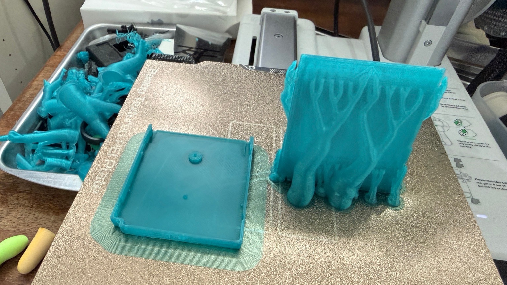
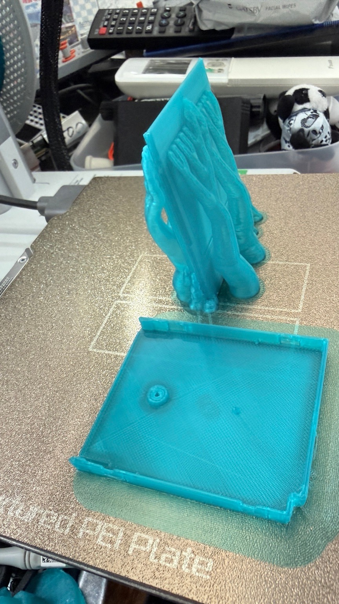
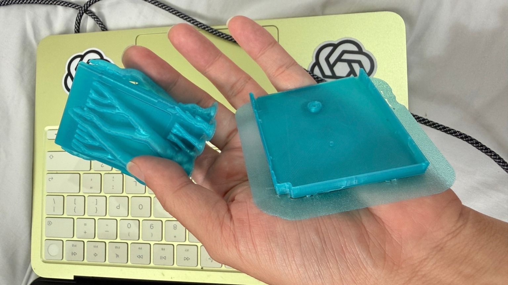
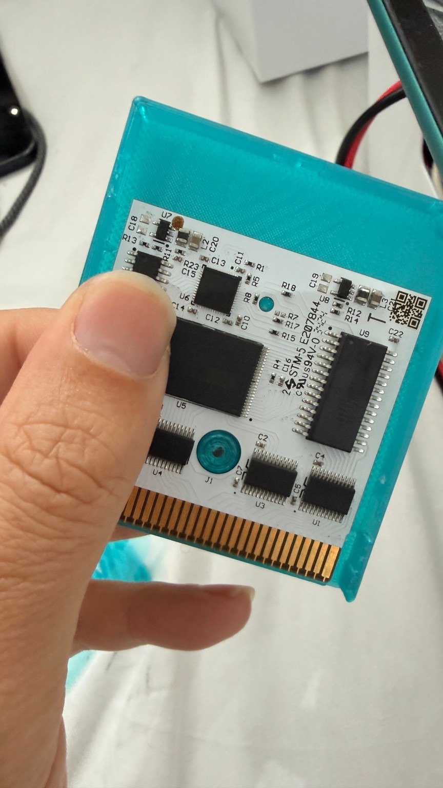
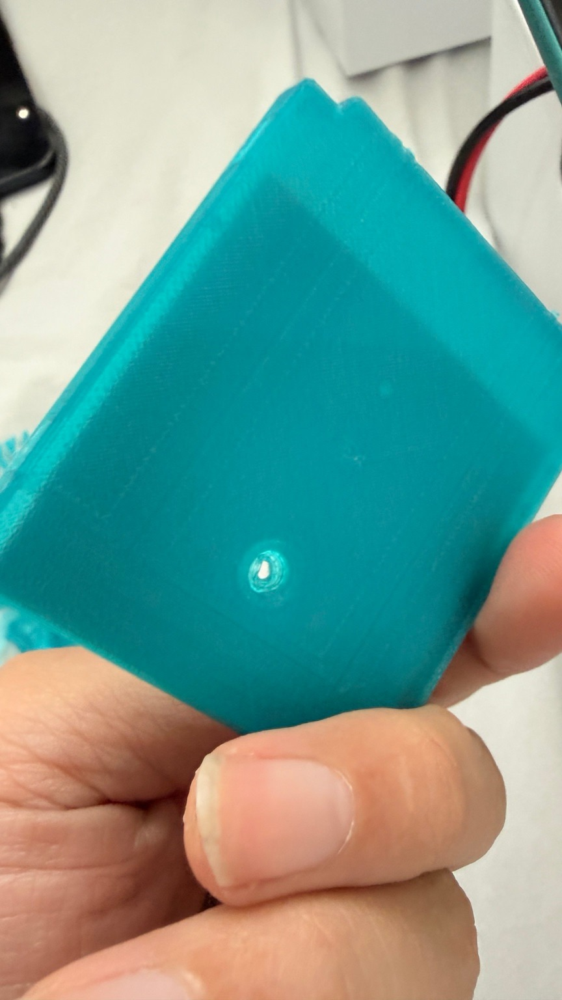
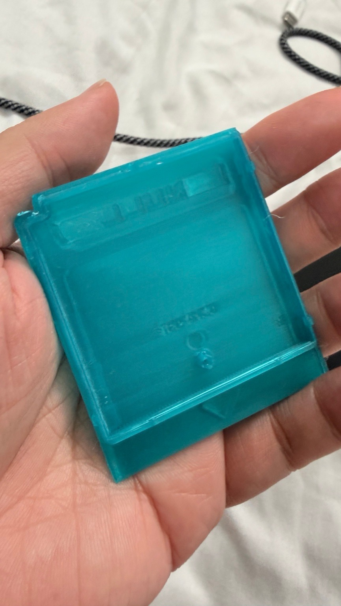
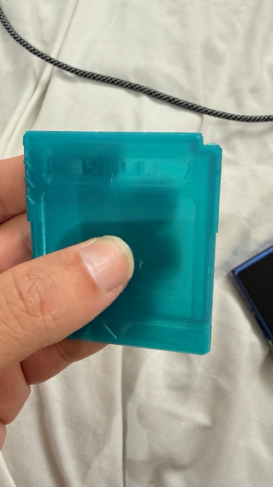
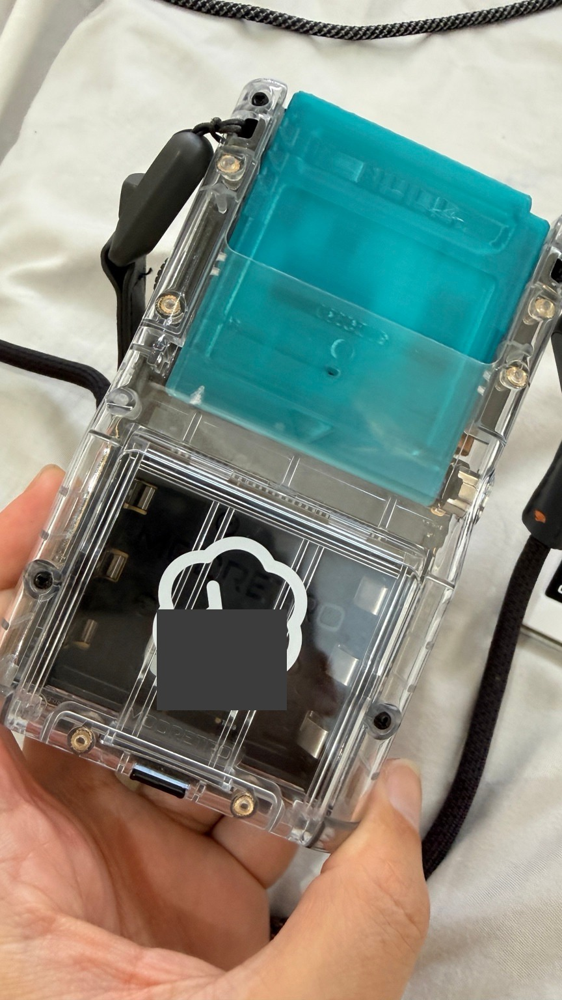

# NULL GB Cartridge

ModRetro公式のChromaticカートリッジ筐体CADをもとに、前面の文字を「NULL」に変更した前後シェルの試作モデルです。2026年10月14日にBambu A1 Miniで実際に印刷した形状を公開しています。

## モデル

STLの単位は **mm**、原寸です。前後各1個を使用します。STLにはサポートやブリムを含みません。ファイルの保存方向と実際の印刷方向は異なるため、下記の配置でスライスしてください。

| パーツ | ファイル | 外形寸法 (mm) |
|---|---|---|
| 前面・NULL文字 | [NULL_front_100-0130_logo_up_mm.stl](models/NULL_front_100-0130_logo_up_mm.stl) | 57.016 × 65.025 × 5.500 |
| 背面 | [Back_100-0129_exterior_up_mm.stl](models/Back_100-0129_exterior_up_mm.stl) | 56.981 × 64.981 × 5.750 |

公式CADの前面100-0130、背面100-0129から筐体のみを取り出しました。前面のMODRETRO文字をNULLの浮き文字に変更し、その他の筐体形状は維持しています。基板・ねじなどのハードウェアは含みません。新しく制作する別モデルは含みません。

メッシュの閉鎖性を確認済みです。今回印刷した3MF内のモデルと三角形数・辺の長さを照合しました。ただし、元のSTL変換はShapr3D Basicの低解像度出力であり、曲面の分割精度には限界があります。

## 今回の印刷設定

| 項目 | 設定 |
|---|---|
| プリンタ | Bambu A1 Mini |
| ノズル | ステンレス 0.4 mm |
| 材料 | PLA（Generic PLAプロファイル） |
| プレート | Textured PEI |
| レイヤー高さ | 0.16 mm |
| 前面の配置 | 外面を上にした基準姿勢からX軸方向に80°起こし、下端をベッドに接地 |
| 背面の配置 | 内側を上にして平置き |
| サポート | ツリー自動、ビルドプレートからのみ、主に前面内側を支持 |
| ブリム | 外側10 mm |
| 壁 | 3周、Arachne |
| サポート接触距離 | 上下Z 0.32 mm、XY 0.50 mm |
| 使用温度 | ノズル220°C、ベッド65°C（今回の既存PLA設定） |
| スライサー見積もり | 約2時間32分、24.47 g（サポート・ブリム込み） |

2026年10月14日12:54 JSTに **100%・402/402層・Finished** を確認しました。温度や配置は今回の記録です。使用するフィラメントと機器に合わせて再スライスしてください。

## 印刷写真

写真は今回の印刷後、サポートとブリムが付いた段階です。1・2枚目はプレート上、3枚目は取り外した状態です。公開画像から位置情報を含む不要なメタデータを除去しています。







上記3枚は印刷直後の記録です。その後の実物検証は次節に記載しています。

## 実物検証（2026年10月14日更新）

ユーザーから「検証したOK」と報告があり、追加写真でも、**今回3Dプリントしたケースで基板の収まりと実機への装着を確認しました。** 対象はこのリポジトリの印刷済みSTLモデルです。別途制作中のSolidCraft新規モデルの適合確認ではありません。

写真では、基板をケース内に収めた状態、サポート除去後のケースの両面、および実機スロットへの装着状態が確認できます。外観の写真は掲載していますが、表面仕上がりの定量評価や寸法公差の測定は行っていません。











追加写真は不要なメタデータを除去し、実機写真の識別番号部分をマスクしています。背面写真だけから実機の機種名は断定していません。

**起動・ゲーム動作などの電気的動作、ネジ締結強度、長期耐久、全機種との互換性は未検証です。** ユーザーの検証OK報告と今回の写真で確認できる範囲を超えて、品質・互換性を保証するものではありません。

## 出典とライセンス

原設計はModRetroです。本リポジトリはModRetro公式製品・公式配布物ではなく、公式公開CADに変更を加えた試作データです。

- [ModRetro公式「Chromatic Open Source Files」](https://support.modretro.com/en_us/chromatic-open-source-files-SJdaK2fRx)
- [公式カートリッジCAD：CHROMATIC_CART_NOTCH_ASSEMBLY_100-0131_01.x_t](https://cdn.shopify.com/s/files/1/0829/2034/1806/files/CHROMATIC_CART_NOTCH_ASSEMBLY_100-0131_01.x_t?v=1723230627)
- 原CADのSHA-256：`699d23425d7da1ee7d7cdbc90240c7420cd3eb40ec6239116e9ac9a417f69ae4`

2026年10月14日時点で、上記の公式CAD配布ページおよび取得したParasolidファイル内には、明示的なライセンス条文を確認できませんでした。「Open Source Files」というページ名だけから利用条件を推定せず、このリポジトリでは新しいライセンスを付与していません。原設計に関する権利・条件は元の権利者に帰属します。利用・再配布等の条件は公式の最新情報を確認してください。ファームウェアの別リポジトリのライセンスを、この筐体CADに適用していません。

## ファイル照合用 SHA-256

```text
190fba32c42523592701a90b8995782612913bdf774ff50f89ed8147f5b9744b  models/NULL_front_100-0130_logo_up_mm.stl
9f324d23f757f7b4f4a5f41028dd55c05d3c694b2c51ab85fbe4dbec9bb7567d  models/Back_100-0129_exterior_up_mm.stl
```
